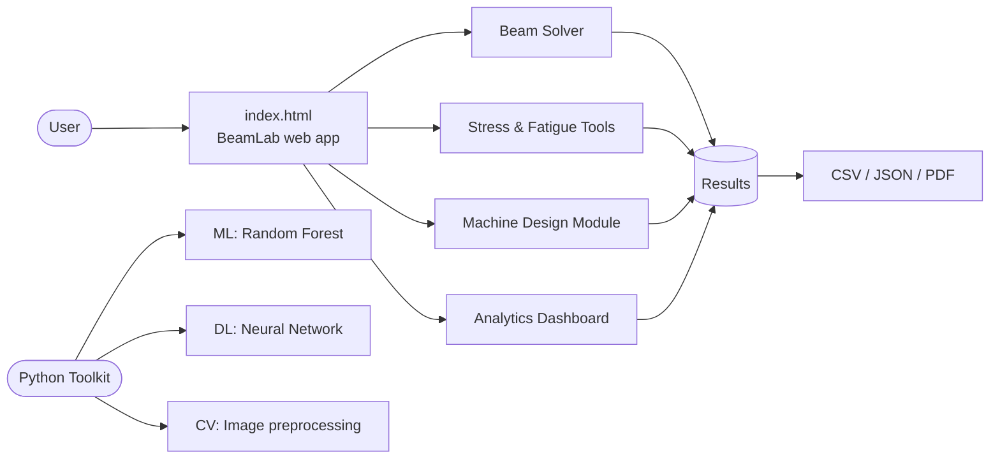
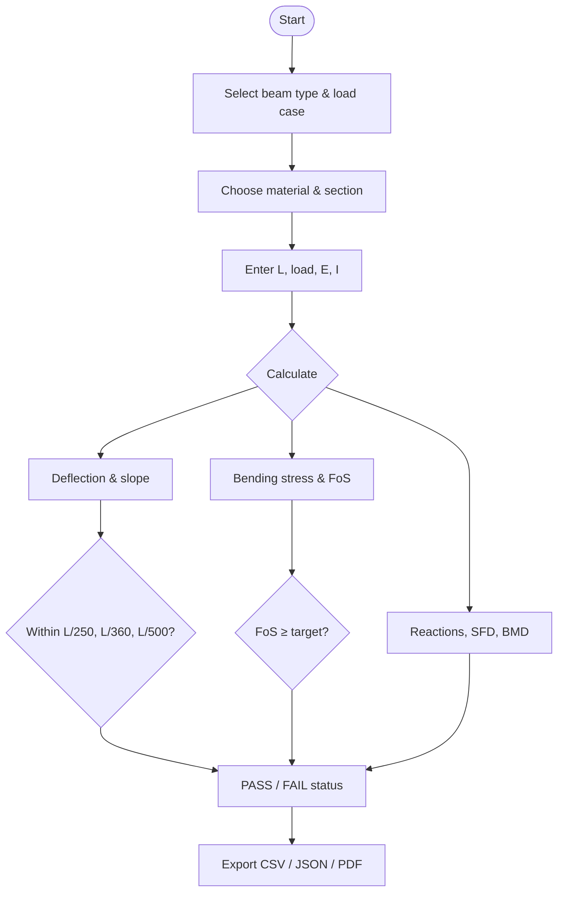
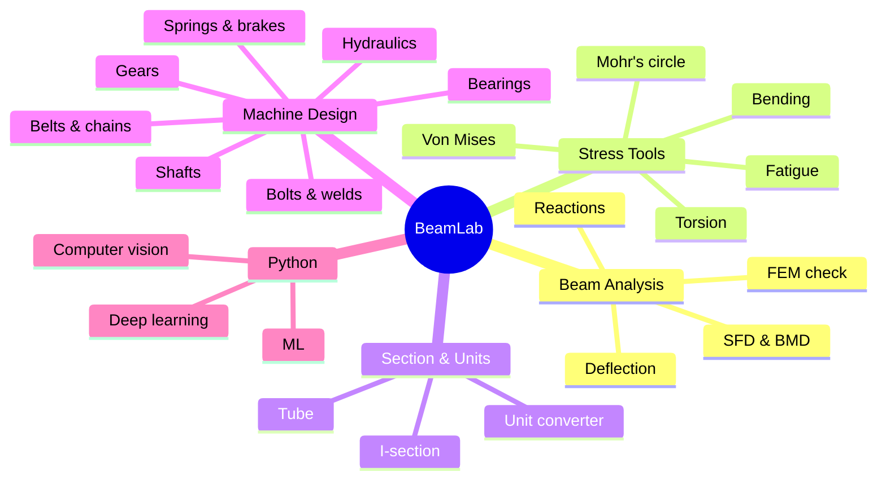

# 📐 BeamLab

**Beam deflection, stress & machine-design calculator that runs entirely in your browser — plus an optional Python ML toolkit.**


> ⚠️ **Educational / preliminary tool.** Not a certified structural or machine-design tool. Always verify with applicable codes and a qualified engineer.

**Author / Copyright:** © 2026 HARPREETSING

---

## ✨ Highlights

- **Beam analysis:** simply supported & cantilever · point load & UDL · deflection, slope, reactions, SFD, BMD
- **Stress & safety:** bending stress, Factor of Safety, combined (von Mises) stress, Mohr's circle, stress concentration
- **Analytics dashboard:** load/span sensitivity, support comparison, 20-element FEM cross-check
- **Machine Design Module:** 60+ calculators — bearings, gears, shafts, belts, bolts, welds, springs, brakes, hydraulics…
- **Exports:** CSV, JSON, print / Save as PDF
- **No install, no API key** — just open `index.html`
- **Python toolkit:** Random Forest, Neural Network, and image-preprocessing examples

## 🚀 Quick Start

**Browser app**
```bash
git clone https://github.com/<your-username>/beamlab.git
cd beamlab
# open index.html in any modern browser
```

**Python toolkit (optional)**
```bash
python -m pip install -r requirements.txt
python python/beam_ml_analysis.py          # Random Forest + charts
python python/beam_deep_learning.py        # optional: TensorFlow NN
python computer_vision/beam_crack_inspection.py path/to/image.jpg   # optional: OpenCV
```

## 🗺️ Architecture



## 🔄 Calculation Workflow



## 🧱 Module Map



## 📁 Project Structure

```text
beamlab/
├── index.html                      # Complete browser app (offline)
├── requirements.txt
├── LICENSE
├── docs/FEATURES.md                # Detailed feature log & formulas
├── python/
│   ├── beam_ml_analysis.py         # Random Forest on synthetic data
│   └── beam_deep_learning.py       # TensorFlow neural network
├── computer_vision/
│   └── beam_crack_inspection.py    # OpenCV preprocessing demo
└── .github/workflows/
    └── deploy-pages.yml            # Auto-deploy to GitHub Pages
```

## 📐 Core Formulas

| Case | Max deflection |
|---|---|
| Simply supported, centre point load | δ = PL³ / 48EI |
| Cantilever, end point load | δ = PL³ / 3EI |
| Simply supported, full UDL | δ = 5wL⁴ / 384EI |
| Cantilever, full UDL | δ = wL⁴ / 8EI |

Bending stress: σ = Mc / I · Factor of Safety: FoS = Fy / σ

Full list of tools and assumptions: [docs/FEATURES.md](docs/FEATURES.md)

## 🌐 Live Demo (GitHub Pages)

Push to `main`, then in **Settings → Pages** choose **GitHub Actions**. The included workflow deploys the app to
`https://<your-username>.github.io/beamlab/`.

## ⚠️ Limitations

- Idealised Euler–Bernoulli beams; no shear deformation, buckling, fatigue life or nonlinear behaviour in the beam solver.
- ML/DL models are trained on **formula-generated synthetic data** — scores do not show real-world accuracy.
- The computer-vision script is image preprocessing, **not** a crack detector.
- Material/grade values are indicative only; check datasheets and standards.

## 📄 License

Released under the [MIT License](LICENSE) — © 2026 HARPREETSING.

## 👤 Author

**HARPREETSING**
